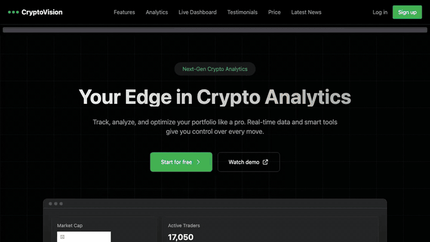

# CryptoVision

Crypto analytics landing page with live market data. React + Vite, deployed on Vercel.

Live: https://crypto-vision-ecru.vercel.app/



## What's on the page

- A price ticker across the top, fed by the Binance 24h ticker endpoint
- A live dashboard section with global market stats, top coins and exchanges from the CoinGecko API
- Line and donut charts built with Recharts
- A full coin table, plus features, pricing, testimonials and latest-news sections
- Login and signup pages (UI only, routed with React Router)

Market data comes from the public CoinGecko and Binance endpoints, so no key is needed to run it. `.env.example` has an optional CryptoCompare key slot.

## Run locally

```bash
npm install
npm run dev
```

## Stack

React 19, Vite, Tailwind CSS 4, Recharts, React Router.
